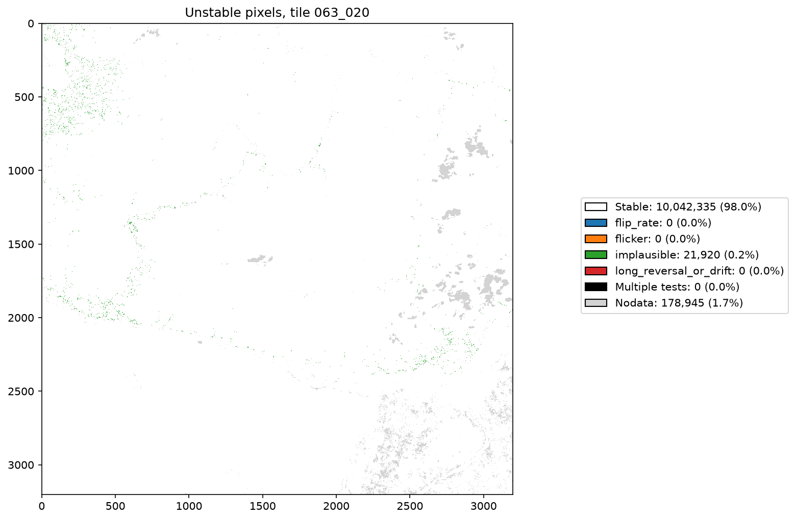
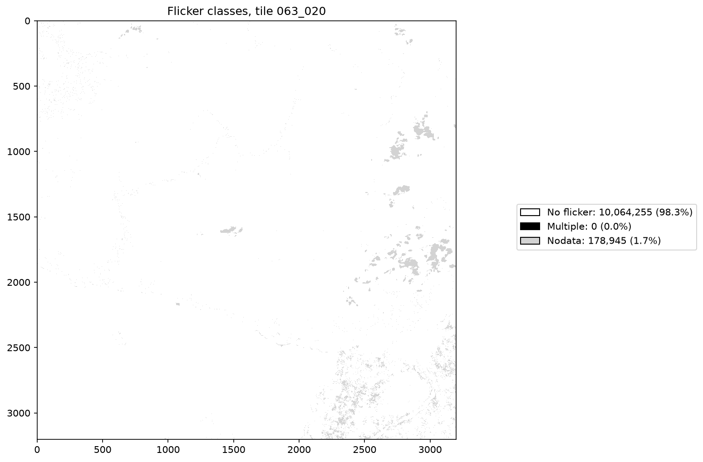
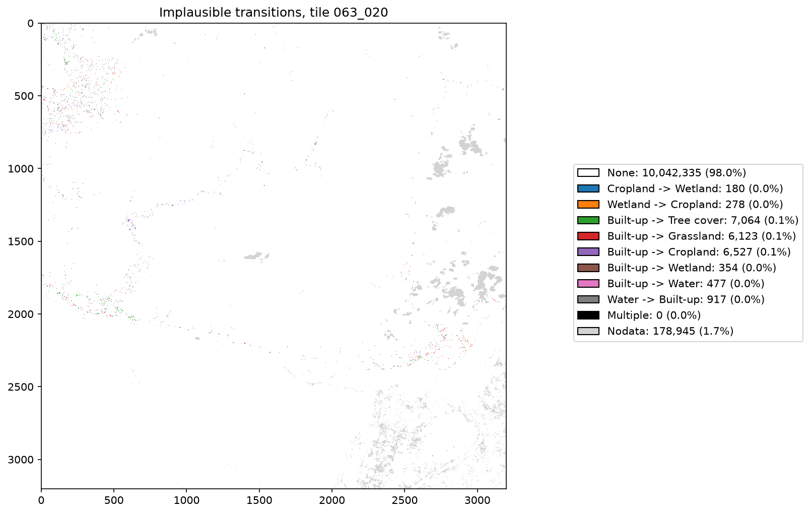
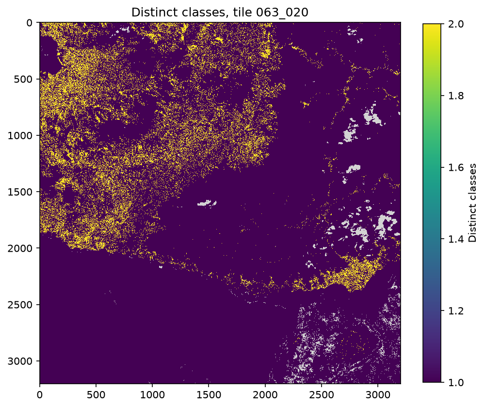

# LULC temporal stability report: version 0-0-9

- LULC: dep_ls_lulc version 0-0-9
- Tiles: 063_020

**Warning:** some tiles have fewer than 26 years of LULC, so the flip rate and flicker tests are weak.

## Years loaded

|  | years loaded | years expected | years |
| - | - | - | - |
| 063_020 | 2 | 26 | 2000-2025 |

## Tests

|  | flagged when |
| - | - |
| flip_rate | more than 4 year-to-year changes |
| flicker | A -> B -> A where B lasts at most 3 years |
| implausible | any transition in the implausible list below |
| long_reversal_or_drift | modal class covers less than 80% of years, more than one change and no flicker |

Implausible transitions: Built-up -> Tree cover, Built-up -> Grassland, Built-up -> Cropland, Built-up -> Wetland, Built-up -> Water, Water -> Built-up, Wetland -> Cropland, Cropland -> Wetland.

## Unstable pixels per tile (count)

A pixel can fail several tests, so the test columns do not sum to `any`. `valid` is the number of pixels tested.

| tile | flip_rate | flicker | implausible | long_reversal_or_drift | any | valid |
| - | - | - | - | - | - | - |
| 063_020 | 0 | 0 | 21920 | 0 | 21920 | 10064255 |

## Unstable pixels per tile (% of valid pixels)

| tile | flip_rate | flicker | implausible | long_reversal_or_drift | any |
| - | - | - | - | - | - |
| 063_020 | 0.0 | 0.0 | 0.2 | 0.0 | 0.2 |

## Unstable pixel map

## Flicker classes

Each A -> B -> A event is found at the first year the pixel returns to A.

## Implausible transitions

## Class stability

Mean share of years each pixel is in its modal class, grouped by modal class. Lower values mean pixels of that class
spend more years in other classes, from real change or misclassification.

| tile | class | pixels | mean_modal_share |
| - | - | - | - |
| 063_020 | Tree cover | 6125579 | 0.942 |
| 063_020 | Grassland | 604735 | 0.928 |
| 063_020 | Cropland | 101823 | 0.894 |
| 063_020 | Wetland | 33405 | 0.925 |
| 063_020 | Built-up | 29621 | 0.957 |
| 063_020 | Water | 3167894 | 1.0 |
| 063_020 | Other | 1198 | 1.0 |

## Distinct classes per pixel

## Class area time series

Year-to-year jumps that coincide with Landsat sensor changes or low GeoMAD observation counts are artefacts, not
land change.

## Caveats

- Pixels with nodata in any year are not tested.
- Class areas use the EPSG:3832 pixel size, which is not equal area.
