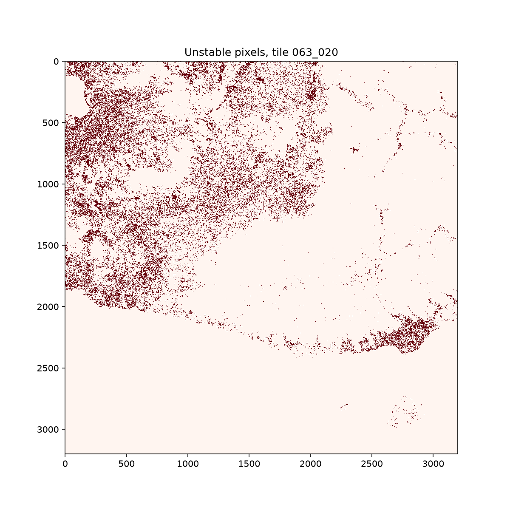
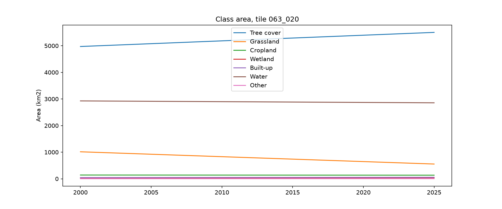

# LULC temporal stability report: version 0-0-9

- LULC: dep_ls_lulc version 0-0-9
- Tiles: 063_020

**Warning:** some tiles have fewer than 26 years of LULC, so the flip rate and flicker tests are weak.

## Years loaded

|  | years loaded | years expected | years |
| - | - | - | - |
| 063_020 | 2 | 26 | 2000-2025 |

## Tests

|  | flagged when |
| - | - |
| flip_rate | more than 4 year-to-year changes |
| flicker | A -> B -> A where B lasts at most 3 years |
| implausible | any transition in the implausible list below |
| low_modal_share | modal class covers less than 80% of years |
| many_classes | more than 3 distinct classes |

Implausible transitions: Built-up -> Tree cover, Built-up -> Grassland, Built-up -> Cropland, Built-up -> Wetland, Built-up -> Water, Water -> Built-up, Wetland -> Cropland, Cropland -> Wetland.

## Unstable pixels per tile (count)

A pixel can fail several tests, so the test columns do not sum to `any`. `valid` is the number of pixels tested.

| tile | flip_rate | flicker | implausible | low_modal_share | many_classes | any | valid |
| - | - | - | - | - | - | - | - |
| 063_020 | 0 | 0 | 21920 | 824877 | 0 | 824877 | 10064255 |

## Unstable pixels per tile (% of valid pixels)

| tile | flip_rate | flicker | implausible | low_modal_share | many_classes | any |
| - | - | - | - | - | - | - |
| 063_020 | 0.0 | 0.0 | 0.2 | 8.2 | 0.0 | 8.2 |

## Unstable pixel map

## Class area time series

Year-to-year jumps that coincide with Landsat sensor changes or low GeoMAD observation counts are artefacts, not
land change.

## Caveats

- Pixels with nodata in any year are not tested.
- Class areas use the EPSG:3832 pixel size, which is not equal area.
