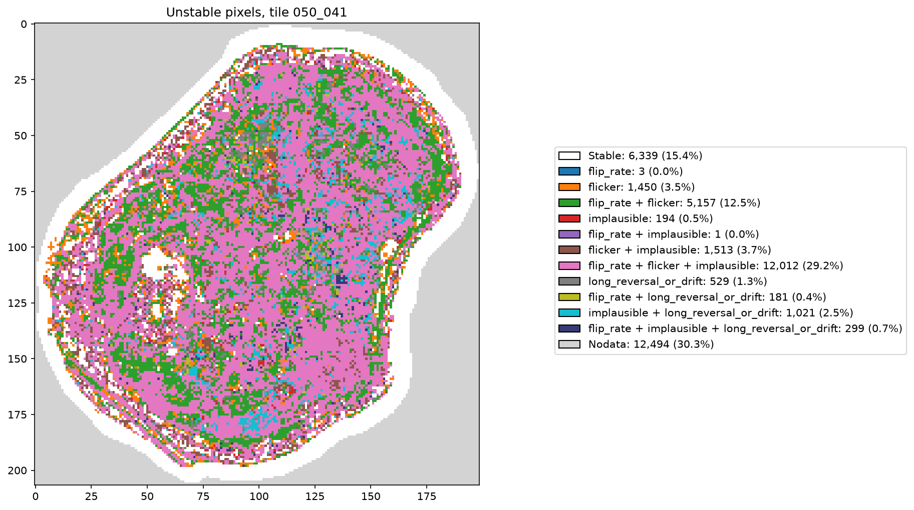
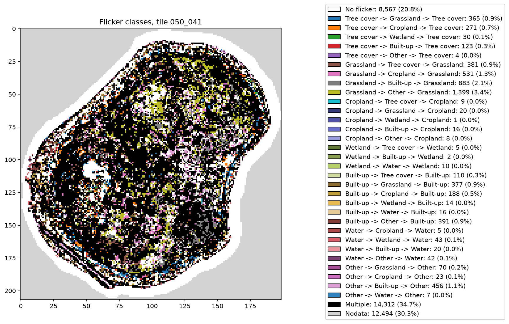
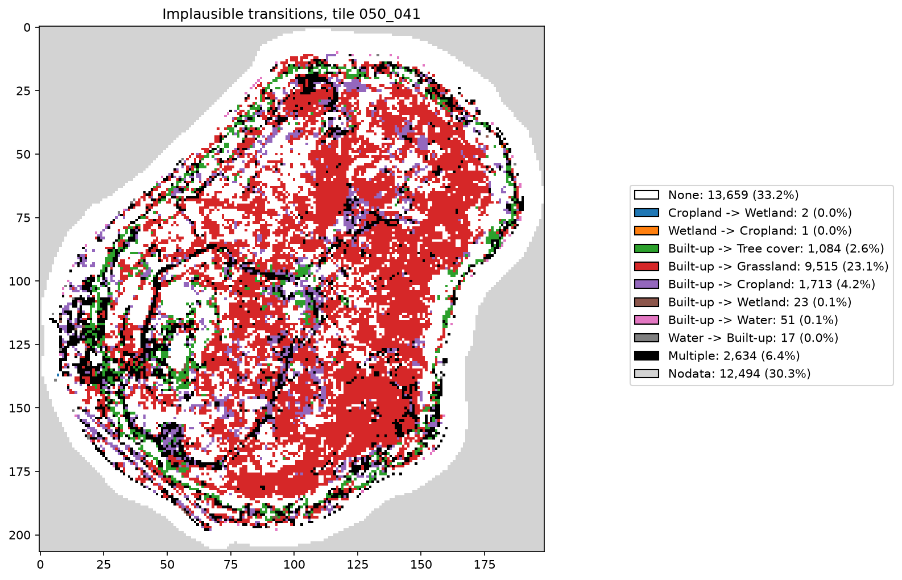
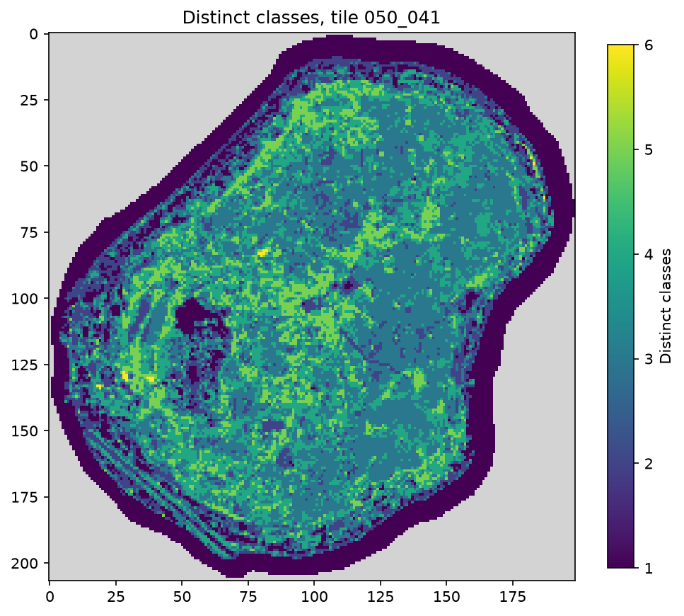
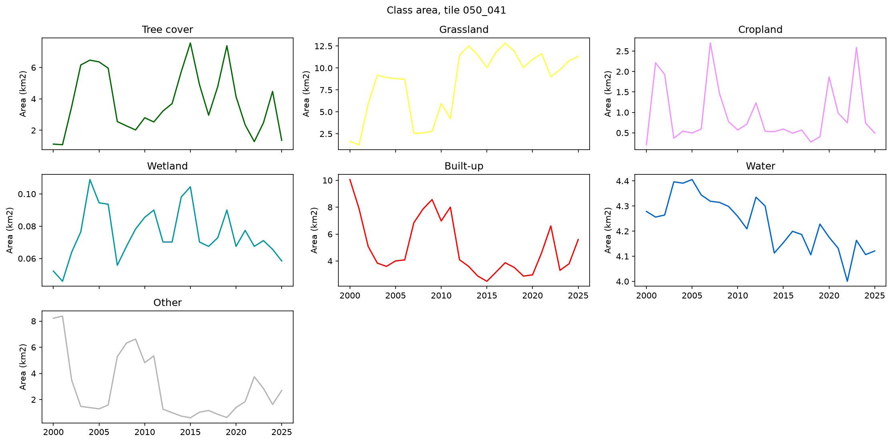
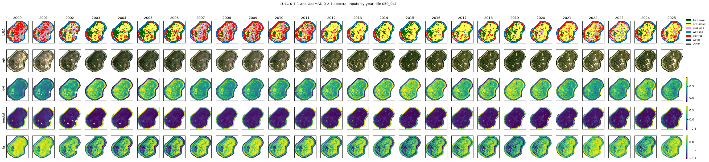
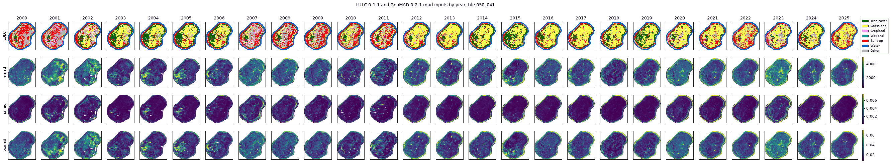
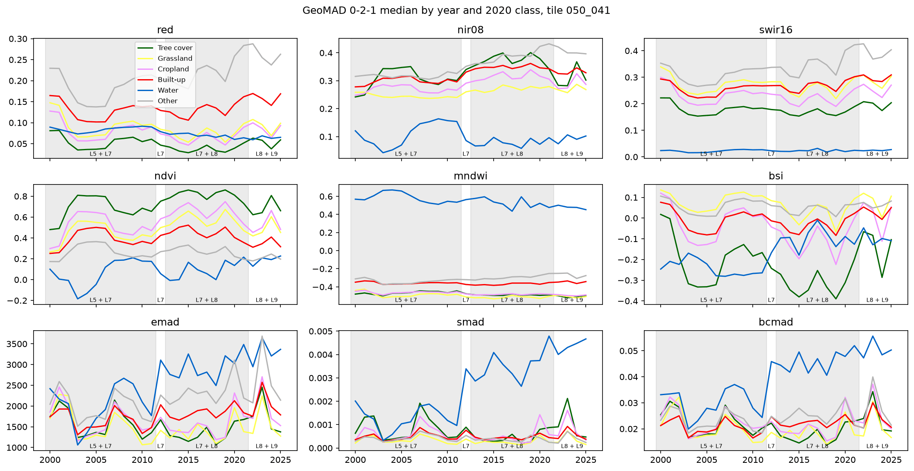

# LULC temporal stability report: version 0-1-1

- LULC: dep_ls_lulc version 0-1-1
- Tiles: 050_041

## Years loaded

|  | years loaded | years expected | years |
| - | - | - | - |
| 050_041 | 26 | 26 | 2000-2025 |

## Tests

|  | flagged when |
| - | - |
| flip_rate | more than 4 year-to-year changes |
| flicker | A -> B -> A where B lasts at most 3 years |
| implausible | any transition in the implausible list below |
| long_reversal_or_drift | modal class covers less than 80% of years, more than one change and no flicker |

Implausible transitions: Built-up -> Tree cover, Built-up -> Grassland, Built-up -> Cropland, Built-up -> Wetland, Built-up -> Water, Water -> Built-up, Wetland -> Cropland, Cropland -> Wetland.

## Unstable pixels per tile (count)

A pixel can fail several tests, so the test columns do not sum to `any`. `valid` is the number of pixels tested.

| tile | flip_rate | flicker | implausible | long_reversal_or_drift | any | valid |
| - | - | - | - | - | - | - |
| 050_041 | 17653 | 20132 | 15040 | 2030 | 22360 | 28699 |

## Unstable pixels per tile (% of valid pixels)

| tile | flip_rate | flicker | implausible | long_reversal_or_drift | any |
| - | - | - | - | - | - |
| 050_041 | 61.5 | 70.1 | 52.4 | 7.1 | 77.9 |

## Unstable pixel map

## Flicker classes

Each A -> B -> A event is found at the first year the pixel returns to A.

## Implausible transitions

## Class stability

Mean share of years each pixel is in its modal class, grouped by modal class. Lower values mean pixels of that class
spend more years in other classes, from real change or misclassification.

| tile | class | pixels | mean_modal_share |
| - | - | - | - |
| 050_041 | Tree cover | 4978 | 0.676 |
| 050_041 | Grassland | 12665 | 0.641 |
| 050_041 | Cropland | 241 | 0.408 |
| 050_041 | Wetland | 65 | 0.787 |
| 050_041 | Built-up | 4795 | 0.724 |
| 050_041 | Water | 4797 | 0.987 |
| 050_041 | Other | 1158 | 0.632 |

## Distinct classes per pixel

## Class area time series

Year-to-year jumps that coincide with Landsat sensor changes or low GeoMAD observation counts are artefacts, not
land change.

## LULC and GeoMAD inputs by year

LULC with the GeoMAD 0-2-1 bands, key indices and MAD bands it was classified from. Each input row uses one
colour scale for all years.

Median of each input per year for the pixels of each 2020 class. Steps that coincide with sensor changes (shaded
eras) point to input artefacts rather than land change.

## Inputs that track the LULC changes

Spearman correlation across years between each input's median over land (water excluded) and the share of pixels in
each class group. Inputs with strong correlations follow the year-to-year LULC changes.

Tile 050_041

| input | built-up + other | tree cover | grassland |
| - | - | - | - |
| blue | 0.97 | -0.85 | -0.72 |
| ndvi | -0.92 | 0.93 | 0.59 |
| bsi | 0.87 | -0.98 | -0.45 |
| red | 0.86 | -0.98 | -0.42 |
| green | 0.82 | -0.98 | -0.38 |
| mndwi | 0.81 | -0.61 | -0.75 |
| nir08 | -0.79 | 0.46 | 0.85 |
| swir22 | 0.76 | -0.99 | -0.27 |
| swir16 | 0.68 | -0.96 | -0.16 |
| emad | 0.36 | -0.49 | -0.21 |
| bcmad | 0.36 | -0.45 | -0.24 |
| smad | 0.3 | -0.26 | -0.33 |

## Caveats

- Nodata years are skipped, so year-to-year tests compare each valid year with the previous valid year.
Pixels with no valid years are not tested.
- Tiles are cropped and masked to Nauru buffered by 200 m.
- Class areas are from LULC reprojected to equal area EPSG:6933 at 30 m with nearest neighbour resampling.
