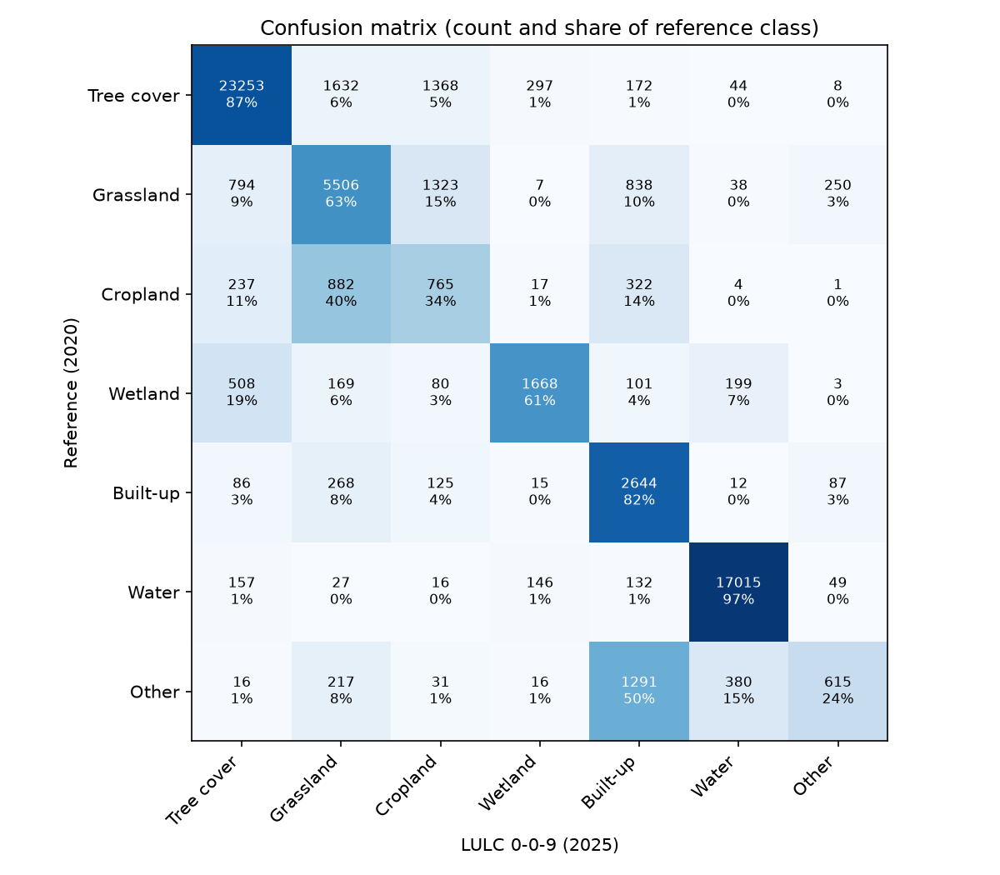

# LULC test report: version 0-0-9, 2025

- Test data: version 0-0-1, labels for 2020, 26 of 27 test tiles
- LULC: version 0-0-9, year 2025
- Tiles with no test data yet: 262_096

**Warning:** labels are for 2020 but the LULC is for 2025, so real land cover change counts as error.

## Coverage

|  | points |
| - | - |
| test points | 64799 |
| tile has no LULC | 0 |
| LULC nodata (below probability threshold) | 968 |
| scored points | 63831 |

## Overall accuracy

95% confidence intervals from 1000 bootstrap replicates that resample whole tiles.

|  | value | ci_low | ci_high |
| - | - | - | - |
| Overall accuracy | 0.806 | 0.737 | 0.873 |
| Cohen's kappa | 0.735 | 0.648 | 0.814 |
| Macro F1 | 0.626 | 0.562 | 0.683 |

## Per class

User's accuracy is precision (of points mapped as a class, the share that are that class). Producer's accuracy is
recall (of points that are a class, the share mapped as it).

| class | reference points | predicted points | user's accuracy (95% CI) | producer's accuracy (95% CI) | F1 (95% CI) |
| - | - | - | - | - | - |
| Tree cover | 26774 | 25051 | 0.93 (0.90-0.95) | 0.87 (0.73-0.95) | 0.90 (0.82-0.94) |
| Grassland | 8756 | 8701 | 0.63 (0.48-0.78) | 0.63 (0.52-0.71) | 0.63 (0.51-0.72) |
| Cropland | 2228 | 3708 | 0.21 (0.08-0.43) | 0.34 (0.21-0.48) | 0.26 (0.12-0.43) |
| Wetland | 2728 | 2166 | 0.77 (0.58-0.87) | 0.61 (0.45-0.74) | 0.68 (0.52-0.78) |
| Built-up | 3237 | 5500 | 0.48 (0.34-0.60) | 0.82 (0.73-0.89) | 0.61 (0.48-0.70) |
| Water | 17542 | 17692 | 0.96 (0.93-0.98) | 0.97 (0.95-0.98) | 0.97 (0.94-0.98) |
| Other | 2566 | 1013 | 0.61 (0.47-0.90) | 0.24 (0.08-0.49) | 0.34 (0.15-0.52) |

## Confusion matrix

## By region

| region | points | overall_accuracy |
| - | - | - |
| non-pacific | 31772 | 0.731 |
| pacific | 32059 | 0.881 |

## By tile (lowest accuracy first)

| region | tile_id | points | overall_accuracy |
| - | - | - | - |
| non-pacific | 193_120 | 3256 | 0.256 |
| pacific | 094_035 | 1745 | 0.533 |
| non-pacific | 128_132 | 3169 | 0.621 |
| non-pacific | 131_135 | 2606 | 0.706 |
| non-pacific | 335_092 | 3507 | 0.714 |
| non-pacific | 312_106 | 3040 | 0.731 |
| non-pacific | 183_123 | 2891 | 0.742 |
| non-pacific | 133_128 | 3412 | 0.78 |
| non-pacific | 138_129 | 3114 | 0.79 |
| pacific | 050_041 | 2145 | 0.791 |
| pacific | 026_059 | 2711 | 0.84 |
| pacific | 073_019 | 2703 | 0.847 |
| pacific | 051_017 | 2907 | 0.867 |
| pacific | 089_016 | 2527 | 0.897 |
| pacific | 040_049 | 2683 | 0.909 |
| pacific | 050_029 | 2242 | 0.923 |
| pacific | 033_031 | 2202 | 0.93 |
| pacific | 032_028 | 2099 | 0.937 |
| pacific | 064_032 | 2161 | 0.949 |
| pacific | 051_052 | 2139 | 0.954 |
| non-pacific | 149_107 | 2692 | 0.958 |
| pacific | 067_016 | 1765 | 0.961 |
| pacific | 115_014 | 1966 | 0.966 |
| non-pacific | 281_109 | 1856 | 0.969 |
| non-pacific | 151_106 | 2229 | 0.991 |
| pacific | 104_022 | 64 | 1.0 |

## Caveats

- Reference labels come from 2-of-3 agreement between ESA WorldCover, ESA CCI and Impact Observatory, not ground truth.
  Agreement favours easy, homogeneous areas, so these accuracies are likely higher than on the whole map.
- Points are sampled with a minimum per class, so overall accuracy is a sample statistic, not an area-weighted map
  accuracy.
- Points within a tile are spatially correlated. The confidence intervals resample tiles to account for this, but with
  few tiles they are wide and approximate.
