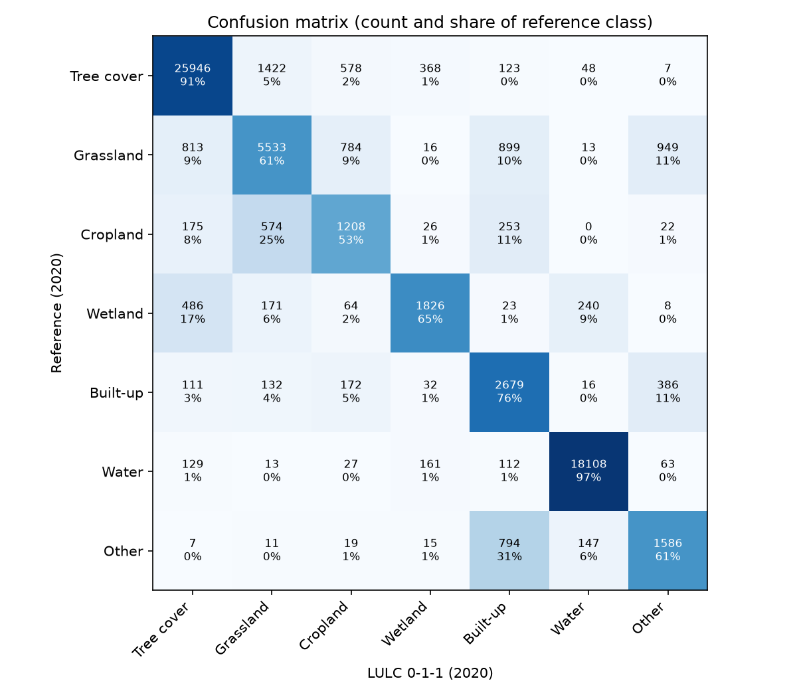

# LULC test report: version 0-1-1, 2020

- Test data: version 0-0-1, labels for 2020, 27 of 27 test tiles
- LULC: version 0-1-1, year 2020
- Tiles with no test data yet: none

## Coverage

|  | points |
| - | - |
| test points | 67554 |
| tile has no LULC | 0 |
| LULC nodata (below probability threshold or no geomad) | 259 |
| scored points | 67295 |

## Overall accuracy

95% confidence intervals from 1000 bootstrap replicates that resample whole tiles.

|  | value | ci_low | ci_high |
| - | - | - | - |
| Overall accuracy | 0.845 | 0.786 | 0.895 |
| Cohen's kappa | 0.787 | 0.715 | 0.847 |
| Macro F1 | 0.703 | 0.632 | 0.763 |

## Per class

User's accuracy is precision (of points mapped as a class, the share that are that class). Producer's accuracy is
recall (of points that are a class, the share mapped as it).

| class | reference points | predicted points | user's accuracy (95% CI) | producer's accuracy (95% CI) | F1 (95% CI) |
| - | - | - | - | - | - |
| Tree cover | 28492 | 27667 | 0.94 (0.92-0.96) | 0.91 (0.84-0.95) | 0.92 (0.89-0.95) |
| Grassland | 9007 | 7856 | 0.70 (0.57-0.81) | 0.61 (0.45-0.78) | 0.66 (0.52-0.77) |
| Cropland | 2258 | 2852 | 0.42 (0.28-0.57) | 0.53 (0.41-0.65) | 0.47 (0.36-0.56) |
| Wetland | 2818 | 2444 | 0.75 (0.57-0.86) | 0.65 (0.51-0.77) | 0.69 (0.56-0.79) |
| Built-up | 3528 | 4883 | 0.55 (0.36-0.72) | 0.76 (0.60-0.88) | 0.64 (0.46-0.78) |
| Water | 18613 | 18572 | 0.98 (0.96-0.99) | 0.97 (0.96-0.98) | 0.97 (0.96-0.98) |
| Other | 2579 | 3021 | 0.52 (0.34-0.84) | 0.61 (0.47-0.75) | 0.57 (0.44-0.72) |

## Confusion matrix

## By region

| region | points | overall_accuracy |
| - | - | - |
| non-pacific | 34960 | 0.793 |
| pacific | 32335 | 0.901 |

## By tile (lowest accuracy first)

| region | tile_id | points | overall_accuracy |
| - | - | - | - |
| non-pacific | 183_123 | 2888 | 0.341 |
| pacific | 094_035 | 1823 | 0.624 |
| non-pacific | 193_120 | 3266 | 0.63 |
| non-pacific | 131_135 | 2854 | 0.78 |
| non-pacific | 128_132 | 3178 | 0.783 |
| non-pacific | 133_128 | 3426 | 0.783 |
| pacific | 073_019 | 2692 | 0.793 |
| non-pacific | 335_092 | 3519 | 0.818 |
| pacific | 026_059 | 2709 | 0.819 |
| non-pacific | 312_106 | 3046 | 0.821 |
| non-pacific | 138_129 | 3142 | 0.858 |
| pacific | 067_016 | 1768 | 0.894 |
| non-pacific | 264_097 | 2747 | 0.92 |
| pacific | 040_049 | 2687 | 0.921 |
| pacific | 051_017 | 2911 | 0.923 |
| pacific | 089_016 | 2534 | 0.931 |
| pacific | 050_029 | 2243 | 0.931 |
| pacific | 032_028 | 2096 | 0.944 |
| pacific | 033_031 | 2202 | 0.947 |
| pacific | 050_041 | 2152 | 0.952 |
| pacific | 064_032 | 2196 | 0.965 |
| non-pacific | 149_107 | 2694 | 0.965 |
| non-pacific | 281_109 | 1974 | 0.969 |
| pacific | 115_014 | 2062 | 0.973 |
| non-pacific | 151_106 | 2226 | 0.981 |
| pacific | 051_052 | 2194 | 0.985 |
| pacific | 104_022 | 66 | 1.0 |

## Version comparison (exact McNemar test)

|  | value |
| - | - |
| only_a_correct | 0.0 |
| only_b_correct | 0.0 |
| p_value | 1.0 |
| accuracy_0-1-1 | nan |
| accuracy_0-0-9 | nan |
| points | 0.0 |

A small p-value means the two versions have different accuracy on the same points.

## Caveats

- Reference labels come from 2-of-3 agreement between ESA WorldCover, ESA CCI and Impact Observatory, not ground truth.
  Agreement favours easy, homogeneous areas, so these accuracies are likely higher than on the whole map.
- Points are sampled with a minimum per class, so overall accuracy is a sample statistic, not an area-weighted map
  accuracy.
- Points within a tile are spatially correlated. The confidence intervals resample tiles to account for this, but with
  few tiles they are wide and approximate.
