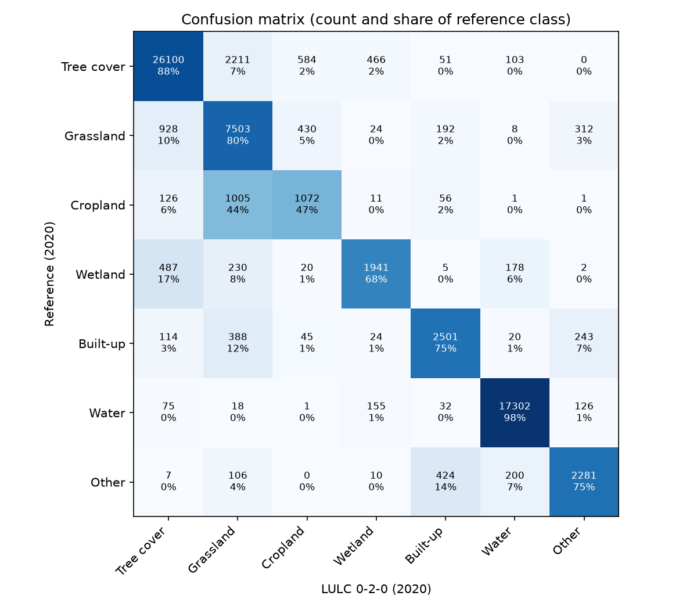

# LULC test report: version 0-2-0, 2020

- Test data: version 0-0-2, labels for 2020, 26 of 26 test tiles
- LULC: version 0-2-0, year 2020
- Tiles with no test data yet: none

## Coverage

|  | points |
| - | - |
| test points | 68280 |
| tile has no LULC | 0 |
| LULC nodata (below probability threshold or no geomad) | 161 |
| scored points | 68119 |

## Overall accuracy

95% confidence intervals from 1000 bootstrap replicates that resample whole tiles.

|  | value | ci_low | ci_high |
| - | - | - | - |
| Overall accuracy | 0.862 | 0.796 | 0.911 |
| Cohen's kappa | 0.809 | 0.723 | 0.871 |
| Macro F1 | 0.759 | 0.693 | 0.806 |

## Per class

User's accuracy is precision (of points mapped as a class, the share that are that class). Producer's accuracy is
recall (of points that are a class, the share mapped as it).

| class | reference points | predicted points | user's accuracy (95% CI) | producer's accuracy (95% CI) | F1 (95% CI) |
| - | - | - | - | - | - |
| Tree cover | 29515 | 27837 | 0.94 (0.92-0.96) | 0.88 (0.76-0.96) | 0.91 (0.84-0.95) |
| Grassland | 9397 | 11461 | 0.65 (0.47-0.83) | 0.80 (0.70-0.86) | 0.72 (0.58-0.83) |
| Cropland | 2272 | 2152 | 0.50 (0.27-0.77) | 0.47 (0.34-0.61) | 0.48 (0.31-0.66) |
| Wetland | 2863 | 2631 | 0.74 (0.52-0.88) | 0.68 (0.57-0.80) | 0.71 (0.57-0.80) |
| Built-up | 3335 | 3261 | 0.77 (0.68-0.84) | 0.75 (0.63-0.87) | 0.76 (0.68-0.82) |
| Water | 17709 | 17812 | 0.97 (0.95-0.99) | 0.98 (0.96-0.99) | 0.97 (0.96-0.98) |
| Other | 3028 | 2965 | 0.77 (0.63-0.91) | 0.75 (0.67-0.85) | 0.76 (0.69-0.84) |

## Confusion matrix

## By region

| region | points | overall_accuracy |
| - | - | - |
| non-pacific | 33483 | 0.801 |
| pacific | 34636 | 0.92 |

## By tile (lowest accuracy first)

| region | tile_id | points | overall_accuracy |
| - | - | - | - |
| non-pacific | 193_120 | 3258 | 0.262 |
| non-pacific | 183_123 | 2907 | 0.756 |
| pacific | 094_035 | 1902 | 0.813 |
| pacific | 067_016 | 1439 | 0.817 |
| non-pacific | 128_132 | 3183 | 0.82 |
| non-pacific | 335_092 | 3526 | 0.828 |
| non-pacific | 133_128 | 3464 | 0.832 |
| non-pacific | 138_129 | 3168 | 0.839 |
| pacific | 026_059 | 2711 | 0.84 |
| pacific | 073_019 | 2696 | 0.84 |
| non-pacific | 141_128 | 3414 | 0.853 |
| non-pacific | 131_135 | 2874 | 0.857 |
| pacific | 089_016 | 2581 | 0.916 |
| non-pacific | 264_097 | 2767 | 0.918 |
| pacific | 040_049 | 2685 | 0.933 |
| pacific | 051_017 | 2917 | 0.938 |
| pacific | 104_023 | 2503 | 0.938 |
| pacific | 033_031 | 2204 | 0.944 |
| pacific | 050_029 | 2247 | 0.947 |
| pacific | 032_028 | 2103 | 0.956 |
| pacific | 064_032 | 2196 | 0.956 |
| non-pacific | 149_107 | 2694 | 0.958 |
| pacific | 050_041 | 2152 | 0.975 |
| pacific | 051_052 | 2243 | 0.979 |
| non-pacific | 151_106 | 2228 | 0.991 |
| pacific | 115_014 | 2057 | 0.994 |

## Caveats

- Reference labels come from 2-of-3 agreement between ESA WorldCover, ESA CCI and Impact Observatory, not ground truth.
  Agreement favours easy, homogeneous areas, so these accuracies are likely higher than on the whole map.
- Points are sampled with a minimum per class, so overall accuracy is a sample statistic, not an area-weighted map
  accuracy.
- Points within a tile are spatially correlated. The confidence intervals resample tiles to account for this, but with
  few tiles they are wide and approximate.
